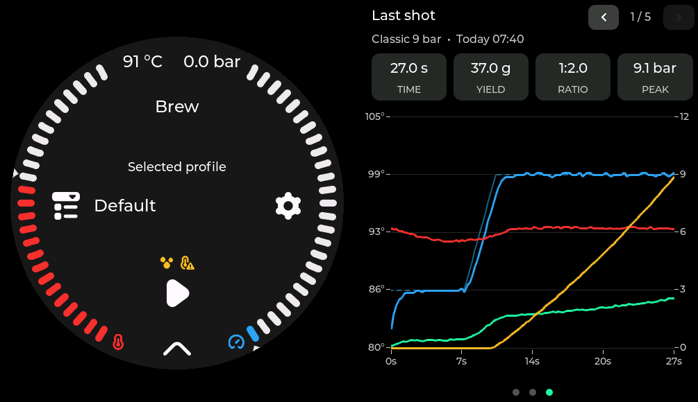

# Waveshare ESP32-P4 7B

GaggiMate display port for the **Waveshare ESP32-P4 7B** (catalogue name: ESP32-P4-WIFI6-Touch-LCD-7B).

Hardware: [ESP32-P4-WIFI6-Touch-LCD-7B](https://www.waveshare.com/esp32-p4-wifi6-touch-lcd-7b.htm?aff_id=96036)

The official 480×480 UI stays an island on the left; side panels use the right half of the 1024×600 panel. LilyGo and other upstream targets are unchanged.



## Try the emulator in your browser

**[Open the P4 simulator](https://0xstuart.github.io/gaggimate/p4-sim/)**

Same layout as the hardware (island + side panels). No board required.

If that link 404s, GitHub Pages may not be published yet on this fork — build locally (below) or check the `gh-pages` branch / Actions tab.

## Flash the board

```bash
# Python 3.12 venv (system 3.14 breaks some pioarduino checks)
uv venv .venv-pio --python 3.12
uv pip install --python .venv-pio/bin/python 'platformio==6.1.19' pyyaml 'esptool>=5.3'

# Optional: embed the real web UI (otherwise an empty stub links)
./scripts/build_webui.sh

# Build + flash (Espressif USB-JTAG — often /dev/ttyACM1; prefer by-id)
./scripts/flash_p4.sh
```

Platform: **pioarduino 55.03.38** (Arduino 3.3.8). Use **esptool ≥ 5.3**. Older pioarduino (55.03.31-2) bootloops on eco7.

## Desktop / local browser simulator

```bash
# SDL desktop (needs libsdl2-dev)
pio run -e display-sim-waveshare-esp32-p4-7b -t run

# Browser build (needs Emscripten)
source ~/emsdk/emsdk_env.sh
python3 sim-web/build.py --serve   # http://localhost:8000
```

## Hardware notes

| Item | Detail |
|------|--------|
| Panel | 1024×600 EK79007 MIPI-DSI (2-lane) |
| Touch | GT911, I2C SDA 7 / SCL 8, reset 23 |
| Backlight | GPIO32 PWM, active-low |
| Radio | ESP32-C6 via ESP-Hosted (SDIO) — Wi‑Fi 6 / BLE |
| Orientation | Firmware sets panel 180° (`ROTATE_180`) for upright mounting |

Pairing with a GaggiMate controller is over BLE (automatic). If the controller is locked to another screen, hold the **steam switch** at controller power-on to open the pairing window.

## Layout

- Island: 480×480 round UI, left half  
- Side panels: `side_panels/` (clock, gauges, graph, last shot, …)  
- Spike (USB / Hosted only, no UI): `spike/` → `scripts/flash_p4_spike.sh`

See [AGENTS.md](../../AGENTS.md) for naming and fork policy (`p4-port` stays shareable; personal extras stay on other branches).
